# Supplementary Materials for: Opine metabolism genes horizontally transferred into fungal genomes

This document contains the legends of Figures S1-S13, Tables S1a-S18 and Data S1-S4 and S2b. The tables are in Supplementary_Tables.xlsx (one sheet per table), the figures in the folders figures/ (PNG) and figures_pdf/ (PDF), the data files as named below. The full text of the Methods is given in Extended Methods (Extended_Methods.docx).

## Figures

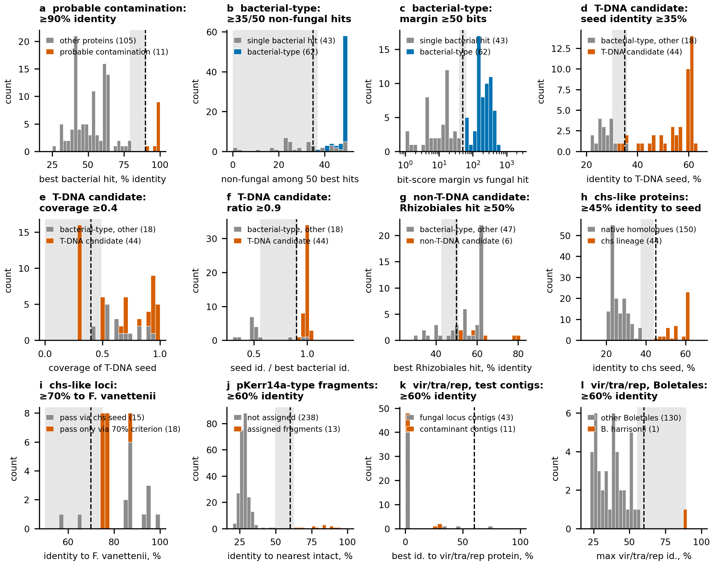

**Figure S1. Distributions of the statistics underlying the thresholds.** The 11 thresholds of the classification of proteins, loci and contigs are shown in 12 panels (the vir/tra/rep threshold has two panels, k and l). Each panel gives the distribution of the underlying statistic (grey, the comparison group; colour, the group passing the threshold), the threshold (dashed line) and the range of threshold values over which the result is unchanged (grey band). (a) probable contamination; (b, c) bacterial-type protein; (d-f) T-DNA candidate; (g) non-T-DNA (rhizobial) candidate; (h, i) chs-like loci; (j) fragments assigned to the pKerr14a-type lineage; (k, l) vir/tra/rep genes on contigs. The numerical results of the sensitivity analysis are in Table S4.

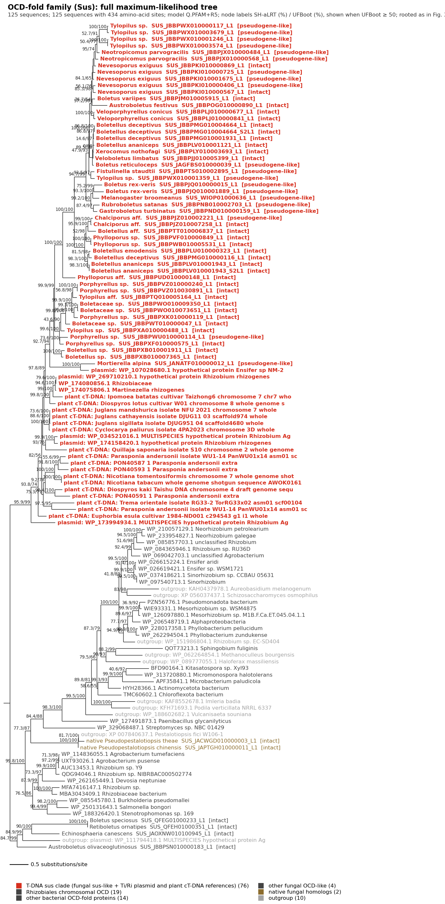

**Figure S2. Full tree of the OCD-fold family (Sus).** The fungal sus-like genes lie within the clade of T-DNA sus genes. Full maximum-likelihood tree of the OCD-fold family (125 sequences, 434 sites, Q.PFAM+R5), from which panel (a) of Figure 3 was collapsed. Leaf colours: T-DNA sus clade (fungal sus-like genes with the Ti/Ri plasmid and plant cT-DNA references), Rhizobiales chromosomal OCD, other bacterial OCD, native fungal homologs, outgroup; key lineages in bold. Node labels, SH-aLRT/UFBoot (%), shown when UFBoot is at least 50; rooted as in Figure 3; scale bar, substitutions per site. Tree, alignment and IQ-TREE report in Data S2 (sus.*).

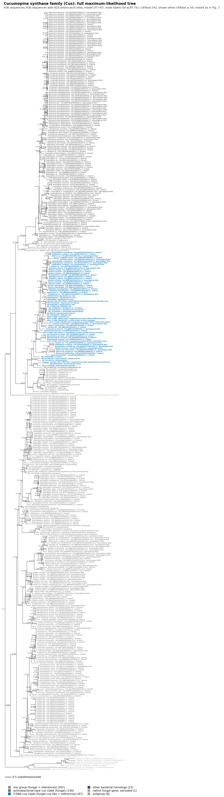

**Figure S3. Full tree of the cucumopine synthase family (Cus).** The fungal cus-like genes lie within the T-DNA cus clade, interleaved with the references. Full maximum-likelihood tree of the cucumopine synthase family (436 sequences, 810 sites, JTT+R7), from which panel (b) of Figure 3 was collapsed: T-DNA cus clade (fungal cus-like genes of Boletales and of other orders with the Ti/Ri plasmid, plant cT-DNA and four other bacterial references), actinobacterial-type clade, mis group, other bacterial homologs, outgroup. In panel (b) of Figure 3 one native fungal gene detected by the cus profile (Boletus austroedulis; excluded from the analysis) is omitted from the schematic; it is labelled here as "native fungal gene, excluded". Supports, rooting and scale as in Figure S2; because of the size of the tree the labels are small and the vector files (PDF, in figures_pdf/) should be used for reading. Data S2: cus.*.

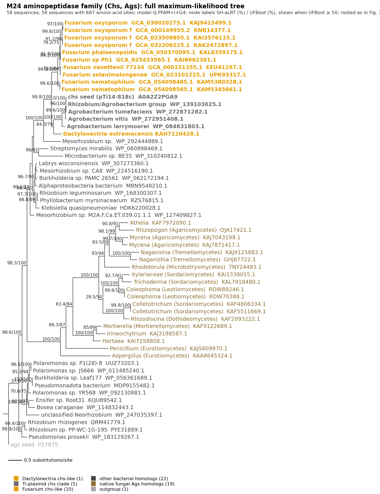

**Figure S4. Full tree of the M24 aminopeptidase family (Chs, Ags).** The Fusarium chs-like genes are sister to the Ti-plasmid chs clade and are not nested within it. Full maximum-likelihood tree of the M24 aminopeptidase family (58 sequences, 687 sites, Q.PFAM+I+G4), from which panel (c) of Figure 3 was collapsed: Fusarium and Dactylonectria chs-like genes, Ti-plasmid chs clade (the chs of pTi14-818c and other agrobacterial chs), native fungal Ags homologs, other bacterial M24 aminopeptidases; rooted on the ags seed. Supports and scale as in Figure S2. Data S2: chs.*.

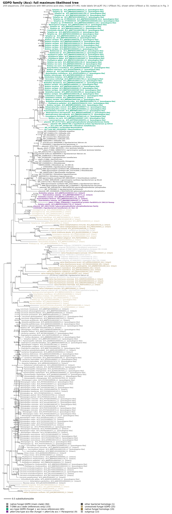

**Figure S5. Full tree of the GDPD family.** The acc-type and pKerr14a-type GDPD genes group with the GDPD of rhizobial acc-like loci and with the acs of pKerr14a, respectively, and not with the T-DNA acs clade. Full maximum-likelihood tree of the GDPD family (259 sequences, 989 sites, JTT+R5), from which panel (d) of Figure 3 was collapsed: T-DNA acs clade, acc-type GDPD with the bacterial acc-locus references, pKerr14a-type acs-like with the acs of pKerr14a and the Parasponia cT-DNA fragment, native fungal GDPD, fungal GDPD of unresolved position, outgroup. Supports, rooting and scale as in Figure S2. Data S2: gdpd.*.

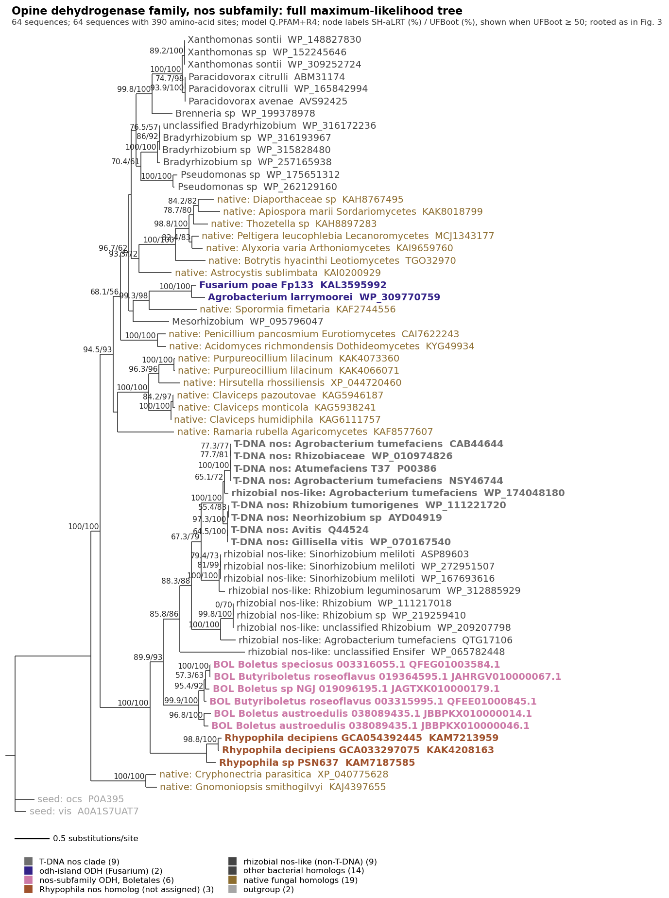

**Figure S6. Full tree of the opine dehydrogenase family, nos subfamily.** The nos-subfamily genes of Boletales form a clade sister to the bacterial genes of the subfamily; the Rhypophila homolog is shown but not assigned to any lineage. Full maximum-likelihood tree of the opine dehydrogenase family around the nos subfamily (64 sequences, 390 sites, Q.PFAM+R4), from which panel (e) of Figure 3 was collapsed: nos-subfamily genes of Boletales, the Rhypophila nos homolog, T-DNA nos clade, rhizobial nos-like genes, odh-island genes, native fungal and other bacterial opine dehydrogenases; rooted on the ocs/vis seeds. Supports and scale as in Figure S2. Data S2: nos.*.

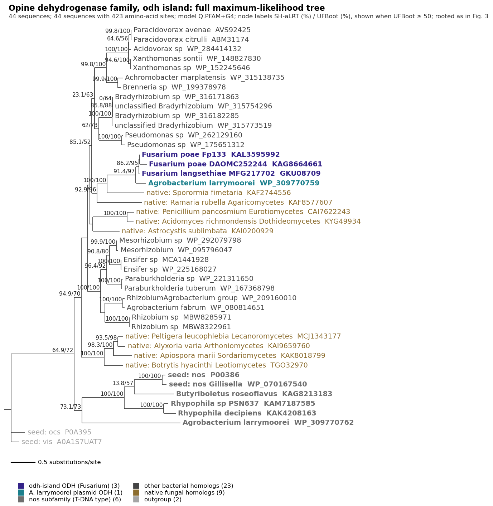

**Figure S7. Full tree of the opine dehydrogenase family, odh island.** The odh-island genes of Fusarium are sister to the plasmid opine dehydrogenase of Agrobacterium larrymoorei. Full maximum-likelihood tree of the opine dehydrogenase family around the odh island (44 sequences, 423 sites, Q.PFAM+G4), from which panel (f) of Figure 3 was collapsed: odh-island genes of F. poae and F. langsethiae, the plasmid opine dehydrogenase of A. larrymoorei (donor locus), nos subfamily, native fungal and other bacterial opine dehydrogenases; rooted on the ocs/vis seeds. Supports and scale as in Figure S2. Data S2: odh.*.

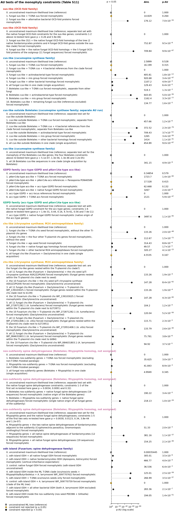

**Figure S8. Approximately unbiased (AU) tests of the lineage hypotheses.** AU tests of the topological constraints for all lineages, drawn from Table S11. Each row is one constrained tree; the dot shows p-AU on a logarithmic scale (dashed line, p = 0.05); squares mark the unconstrained maximum-likelihood tree of each run; dlnL, log-likelihood difference from the best tree. Yellow, constraint not rejected; black, rejected. Hypotheses are worded as in Table S11 (Methods 2.6).

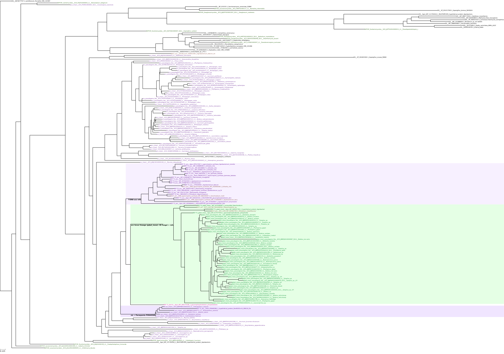

**Figure S9. Structural phylogeny of the GDPD family.** A tree built from predicted protein structures reproduces the sequence-based GDPD lineages. Maximum-likelihood tree built from the structural alignment (FoldMason, 3Di and amino-acid alphabets) of ColabFold models of the GDPD family (Methods 2.6). Shaded: the T-DNA acs references, the acc-type lineage (48 fungal genes with the acc-locus references) and the pKerr14a-type lineage (fungal genes with the acs of pKerr14a and the Parasponia cT-DNA fragment). Leaf colours: fungal loci (intact, pseudogene-like), T-DNA and plant cT-DNA references, bacterial references, native fungal homologs, outgroup.

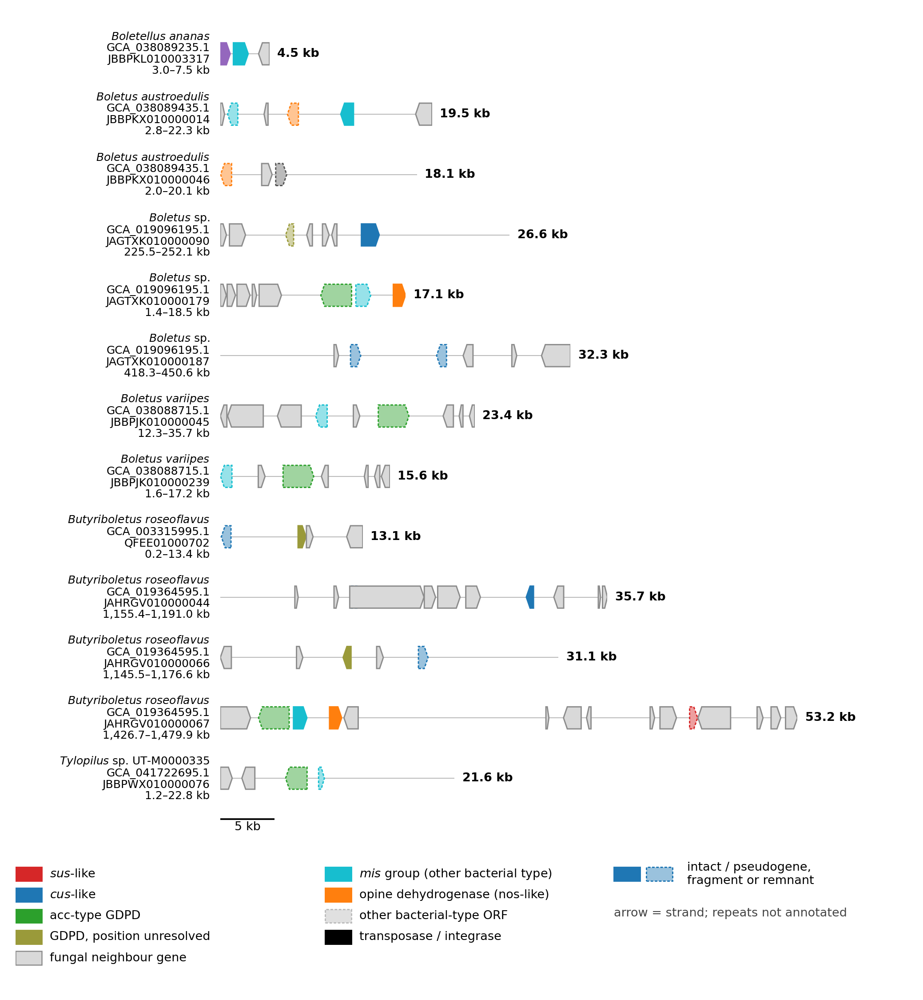

**Figure S10. All opine islands of Boletaceae.** All opine islands of Boletaceae: the 13 contigs (7 assemblies of 6 species or species-level taxa) carrying two or more loci of bacterial type at distinct positions (Table S12), drawn to a common scale as in Figure 4a; each window spans the loci with 12 kb on each side (within the gene set of Table S12). Genes of the lineages of bacterial origin (sus-like, cus-like, acc-type GDPD, nos-subfamily opine dehydrogenase) are coloured as in Figure 4; loci of the nos-subfamily opine dehydrogenase lineage, found by blastx and therefore absent from Table S12, are included (Table S1b; contigs with such a locus and no other locus of bacterial type are not shown); other genes of bacterial type (mis group; other bacterial-type ORF) and the GDPD gene of unresolved position are shown in separate colours (legend); fungal neighbour genes grey; transposases and integrases black; dashed outline, pseudogene, fragment or remnant. Lineages and gene states are those of Table S1b. Arrows show the strand. Repeats are not drawn, because repeat annotation exists only for the contigs of Figure 4a. Contigs with a single locus are not shown. On JBBPKX010000014 the nos-subfamily gene (pseudogene) lies on the same strand as the intact mis-group gene, 3.9 kb downstream of it.

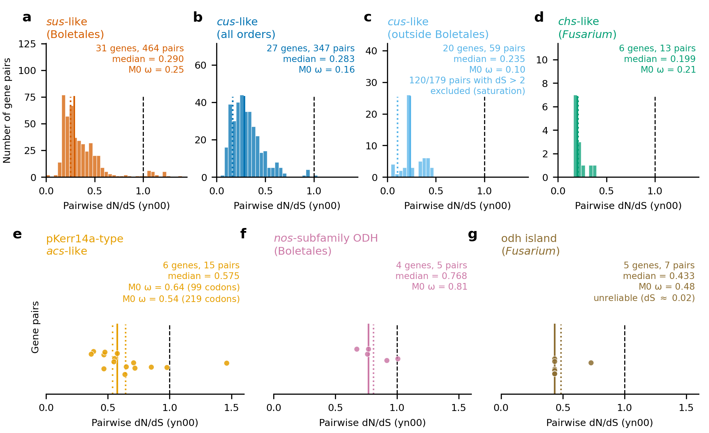

**Figure S11. Pairwise dN/dS of the intact genes of each lineage.** Pairwise dN/dS (yn00) between intact genes of each lineage: (a) sus-like genes of Boletales (31 genes, 464 pairs); (b) all cus-like genes (27 genes, 347 pairs); (c) cus-like genes outside Boletales (20 genes; 59 pairs with dS <= 2 shown, 120 of 179 pairs excluded as saturated); (d) chs-like genes of Fusarium (6 genes, 13 pairs); (e) pKerr14a-type acs-like genes (6 genes, 15 pairs; M0 omega for the strict 99-codon and the 219-codon alignment); (f) nos-subfamily opine dehydrogenase genes of Boletales (4 genes, 5 pairs); (g) odh-island genes of Fusarium (5 loci, 7 pairs; unreliable, dS about 0.02). Histograms (a-d) or individual pairs (e-g); solid coloured line, median pairwise dN/dS; dotted line, omega of the M0 model (codeml); dashed black line, dN/dS = 1. The acc-type GDPD lineage (3 intact of 60 loci) was not tested. Values in Table S15.

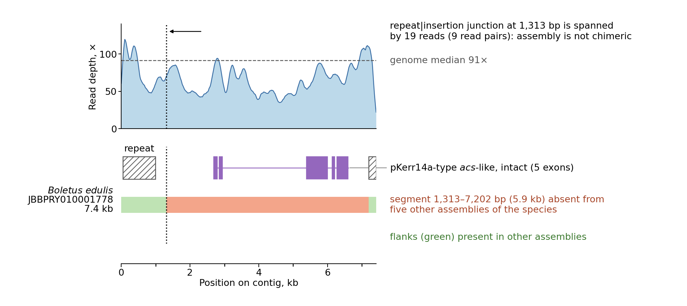

**Figure S12. The strain-specific insertion on contig JBBPRY010001778 of Boletus edulis.** The strain-specific insertion on contig JBBPRY010001778 of Boletus edulis (7.4 kb; Figure 4b). Top, read depth along the contig (smoothed over 200 bp; dashed line, genome median 91x); the repeat-insertion junction at 1,313 bp (dotted line) is spanned by 19 reads (9 read pairs), which supports the continuity of the contig across this junction. Bottom, the gene model of the pKerr14a-type acs-like gene (five exons, purple), flanking repeats (hatched), and the 5.9-kb segment (1,313-7,202 bp; red) absent from five other assemblies of the species, with the flanks present in other assemblies (green). Read depth of all loci in Table S8; reproducibility in independent assemblies in Table S9.

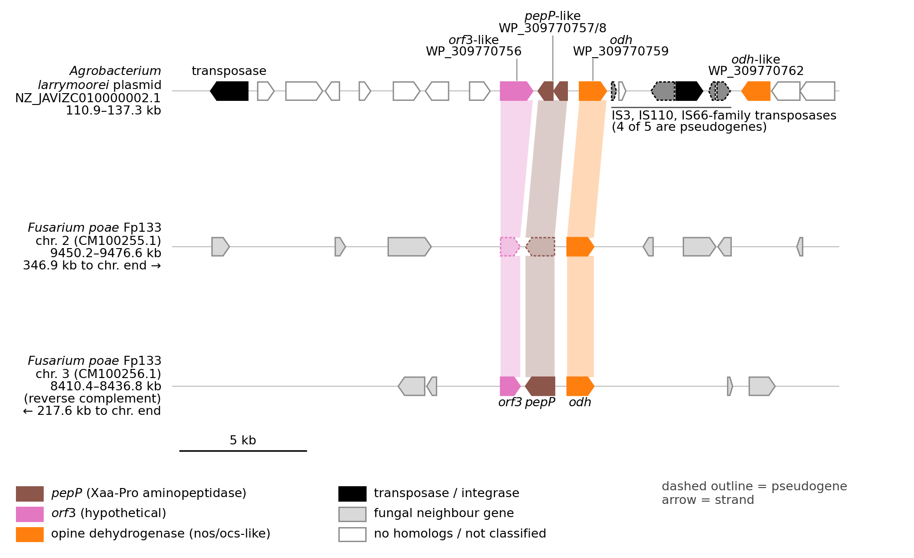

**Figure S13. Both chromosomal copies of the odh island of Fusarium poae Fp133.** Both chromosomal copies of the odh island of F. poae Fp133 compared with the homologous locus of the A. larrymoorei plasmid NZ_JAVIZC010000002.1 (Figure 4c shows the chromosome 2 copy only). Top, plasmid locus (110.9-137.3 kb), where the cassette is bounded by IS3-, IS110- and IS66-family transposases; middle, chromosome 2 (CM100255.1, 9,450.2-9,476.6 kb; 346.9 kb to the chromosome end); bottom, chromosome 3 (CM100256.1, 8,410.4-8,436.8 kb, shown as the reverse complement; 217.6 kb to the chromosome end). Ribbons connect the homologous genes orf3, pepP and odh; dashed outline, pseudogene or fragment; arrows indicate strand. Scale bar, 5 kb.

## Tables

**Table S1a. Loci of bacterial origin.** The 254 loci of the seven lineages of bacterial origin (239 placed on the phylogenetic trees directly or through a representative, 13 fragments assigned by identity, 2 added from NCBI annotations after the trees were built; named after their closest bacterial relatives) - one row per locus, with coordinates, structural status, the route of detection and the supplementary tables in which the locus appears. The 152 additional fragments and remnants of the same lineages assigned by HMM profile only (not placed on a tree) are listed in Table S1b (lineage_of_bacterial_origin = True, lineage with the suffix '(profile only)'). Protein sequences in Data S1 (254 of the 254 loci). Integration status (column integration_status), assigned by fixed rules (Methods 2.5) from the per-neighbour classification of the flanking genes (nr hits; hits to the carrier genus alone do not count), Table S8 (read depth), Table S9 (independent assemblies), Tables S13a, S13b and the NCBI assembly reports: confirmed = at least one of (i) a gene classified as fungal on both sides of the locus, (ii) the locus and both flanks covered (>= 0.5) by an independent assembly of the species (Table S9), (iii) the locus on a sequence listed as an assembled-molecule chromosome in the NCBI assembly report, >= 1 kb from both ends, or (iv) read-depth ratio 0.5-2 with junction reads on both flanks (Table S8); uncertain (not assessable; applied next) = a contig shorter than the locus plus 2 kb, or a locus touching a contig end; supported = none of the above and at least one of a fungal gene on one side only, a contig >= 100 kb with the locus away from its ends and a depth ratio not outside 0.5-2, a depth ratio 0.5-2 without junction reads on both flanks, or a gene of the same lineage present in two or more assemblies of the species without verification of the flanks (Tables S13a, S13b); the remaining loci (a depth ratio outside 0.5-2 without other support, or no classified neighbours and no other support) are uncertain. Columns: locus_id, Locus identifier (as in Table S1b and in the headers of Data S1); lineage, Lineage of bacterial origin (seven lineages; the odh island has three genes); origin, Origin of the lineage as established in the paper (T-DNA gene or rhizobial locus outside the T-DNA); status, Locus state: intact, pseudogene, truncated, fragment, remnant or ambiguous; species, Species name used in the paper; order, Taxonomic order; taxonomic_family, Taxonomic family of the carrier fungus; assembly, Genome assembly accession; contig, Contig/scaffold accession; contig_length_bp, Contig length, bp; start, Locus start on the contig (1-based); end, Locus end on the contig; strand, Strand; n_exons, Number of exons in the gene model; protein_length_aa, Length of the fungal protein model, aa (for loci with a sequence in Data S1 it equals the length of that sequence; blank where no model could be built; for profile-screen loci with a gene model, the length of that model); genomic_context, Flanking-gene context call (fungal, mixed, bacterial, short contig, no neighbours); integration_status, Integration status of the locus in the fungal genome: confirmed, supported or uncertain (rules in the table legend); detection_route, Route by which the locus was found: profile screen, targeted scan (miniprot), blastx of plasmid proteins, or protein-level screen; detailed_in, Table with the per-locus details of the corresponding screen; evidence_tables, Supplementary tables in which the locus appears: by locus_id (S8, S14, S13a, S13b, S16), by contig and assembly (S9, S12, S10b, S5a; contig-level, so also listed for other loci on the same contig), for the odh island by gene (S13c, reverse search of the island genes; S16, RNA-seq of the Fp133 copies); blank = none; protein_in_Data_S1, yes if the translation of the locus is in Data S1 (no gene model, hence no protein, for the others); note, Free-text note. See Supplementary_Tables.xlsx, sheet S1a.

**Table S1b. Complete catalogue of loci.** All loci of all lineages found in fungal genomes by the two routes of the screen: the profile screen (HMM/tblastn) of the GDPD, Cus and Sus families, and the targeted scans (chs-like loci, odh island, nos-subfamily opine dehydrogenases; details in Tables S10b, S13a and S13b). For each locus: family, assigned lineage and its origin, route of detection, evidence for the assignment, structural status and genomic coordinates. Loci marked 'not a homolog' are retained as a separate category (hits that failed the homology checks). The 254 loci of the seven lineages of bacterial origin (239 placed on the trees directly or through a representative, 13 fragments assigned by identity, 2 added from NCBI annotations after the trees were built) are listed separately, with additional columns, in Table S1a; the 152 fragments of the same lineages assigned by profile only are flagged here (column lineage_of_bacterial_origin = True, lineage with the suffix '(profile only)'). One row per locus. Columns: locus_id, Locus identifier (family prefix, contig, locus number); family, Protein family: GDPD, cucumopine synthase (Cus), OCD fold (Sus), M24 aminopeptidase (Chs/Ags) or opine dehydrogenase; lineage, Final lineage assignment; '(profile only)' = assigned by HMM profile only, not placed on a tree; origin, Origin of the lineage as established in the paper (T-DNA gene; rhizobial locus outside the T-DNA; native fungal family; not analysed); lineage_of_bacterial_origin, True if the locus belongs to one of the seven lineages of bacterial origin (placed on the tree or assigned by profile only); the placed loci are also listed in Table S1a; detection_route, Route by which the locus was found: profile screen, targeted scan (miniprot), blastx of plasmid proteins, or protein-level screen; detailed_in, Table with the per-locus details of the corresponding screen; assignment_basis, Evidence for the lineage (profile-screen loci): phylogenetic tree, sequence similarity, or HMM profile only; blank for loci of the targeted scans (see detailed_in); hmm_profile_subgroup, Best-matching HMM profile subgroup (the GDPD acs profile is not a tree-based lineage); status, Locus state: intact, pseudogene, fragment, remnant, ambiguous, not a homolog, not modelled (no gene model built); organism, Organism name (NCBI); species, Species name used in the paper; phylum, Taxonomic phylum; class, Taxonomic class; order, Taxonomic order; taxonomic_family, Taxonomic family of the carrier fungus; assembly, Genome assembly accession; mash_species_cluster, Genome cluster (mash) name; blank if not clustered; contig, Contig/scaffold accession; contig_length_bp, Contig length, bp; start, Locus start on the contig (1-based); end, Locus end on the contig; strand, Strand; n_exons, Number of exons in the gene model; protein_length_aa, Length of the fungal protein model, aa (for loci with a sequence in Data S1 it equals the length of that sequence; blank where no model could be built; for profile-screen loci with a gene model, the length of that model); genomic_context, Flanking-gene context call (fungal, mixed, bacterial, short contig, no neighbours); note, Free-text note; species_name_source, Where the species name comes from: NCBI binomial or mash cluster. See Supplementary_Tables.xlsx, sheet S1b.

**Table S1c. Summary of the catalogue by group.** Per-group summary of the catalogue of loci (Table S1b): the seven lineages of bacterial origin (Table 2 of the main text) and the groups of the catalogue that belong to native fungal families or were not analysed further. One row per group. Columns: group, Tree-defined group of the catalogue (Table S1b). The first nine rows (main_lineage = True) are the seven lineages of bacterial origin (the odh island has three genes); the remaining rows are groups of native fungal families or groups whose origin was not analysed; family, Protein family; origin, Closest relatives / source of the group as established in Results 3.4 ('not analysed' for the groups outside the seven lineages); entry_route, Route by which the loci entered the screen (Methods 2.2); n_loci, Loci of the lineage in Table S1a (placed on a tree directly or through a representative, or assigned by identity, or added from NCBI annotations); intact, Intact genes; pseudogene, Pseudogenes (disrupted reading frame); truncated, Truncated copies (reading frame intact, coverage below 90%; chs-like loci of Fusarium); fragment, Fragments and remnants too short to be placed on a tree, assigned by identity (pKerr14a-type) or profile; other, Loci with another status; n_assemblies, Assemblies with a placed locus; n_species, Distinct NCBI species names; n_orders, Fungal orders; assemblies_Boletales, Carrier assemblies in Boletales; assemblies_Agaricales, Carrier assemblies in Agaricales; assemblies_Hypocreales, Carrier assemblies in Hypocreales; assemblies_other_orders, Carrier assemblies in other orders (order and count); fragments_assigned_by_profile_only, Loci detected only by the profile scan and not placed on a tree; assemblies_incl_fragments, Assemblies with any locus of the group, including profile-only fragments; lineage_of_bacterial_origin, True for the seven lineages of bacterial origin. See Supplementary_Tables.xlsx, sheet S1c.

**Table S1d. Sensitivity of the lineage counts to the integration status of the loci.** The counts of Table 2 (loci, intact loci, carrier species and assemblies per lineage) and the inputs of Figure 5 (genus rows and species-level clusters of Boletales with the lineage, and with an intact copy) computed from all 254 loci of the seven lineages (239 placed on the trees directly or through a representative, 13 fragments assigned by identity, 2 added from NCBI annotations after the trees were built; column all_loci) and from the loci whose integration in the fungal genome is confirmed or supported only (column confirmed_supported_only; Table S1a, column integration_status). Columns: lineage, Lineage (prefixed by the table or figure the metric belongs to); metric, Metric; all_loci, Value over all 254 loci of the seven lineages; confirmed_supported_only, Value over the confirmed and supported loci only. See Supplementary_Tables.xlsx, sheet S1d.

**Table S2. Seed proteins.** Query (seed) proteins used for the protein-level screen of fungal proteomes: bacterial Ti/Ri-plasmid proteins and plant cellular T-DNA (cT-DNA) proteins. Columns: gene, Gene/protein class the seed represents; seed_id, Accession or identifier of the seed protein; source, Seed source: bacterial or plant cT-DNA; seed_group, Family/lineage group of the seed (blank for reference seeds of other genes); seed_set, Seed set: curated panel, reference seed, or member of a T-DNA gene cluster; description, Organism / product / original record description; length_aa, Seed length, aa. See Supplementary_Tables.xlsx, sheet S2.

**Table S3. Reverse search of the 1,277 query proteins against NCBI nr and the fate of each.** All queries of the reverse search of the protein-level screen: 1,277 queries (protein x seed-gene pairs) for 1,190 distinct proteins, because 83 proteins were detected by two or three seed genes. Each query was searched against NCBI nr and the best hits outside the protein's own order were compared (columns best_bacterial, best_plant and best_fungal_hit_outside_own_order). Index h = best bacterial or plant bit score minus best outside-order fungal bit score, as computed in the screen; the 116 queries with non-fungal closest relatives (h > 0; Results 3.1; column nonfungal_nearest = yes) are listed first, followed by the 1,161 queries whose closest relatives are fungal (h <= 0; nonfungal_nearest = no); each group is sorted by gene. The fate of each query in the funnel (column fate) is one of the five categories of Table 1 (probable contamination; member of a fungal family with a single better bacterial hit; bacterial-type protein unrelated to rhizobia, not analysed further; T-DNA candidate; non-T-DNA (rhizobial) candidate) or, for h <= 0, 'fungal nearest relatives (no further analysis)'. Queries from the GenBank/RefSeq duplicate of an assembly are kept and flagged (column duplicate_assembly). Columns: gene, Seed gene/protein class; organism, Organism; assembly, Genome assembly accession; protein, Protein accession; identity_to_seed_pct, Identity to the nearest seed of the gene, %; the seeds include plant cT-DNA proteins, so this is not identity to the bacterial genes; identity_to_bacterial_seed_pct, Identity to the nearest bacterial T-DNA seed of the same gene (30 bacterial seeds; DIAMOND blastp), %; given only for the T-DNA candidates analysed in Tables S17a,b, blank otherwise; seed_coverage, Fraction of the seed covered; best_bacterial_hit_organism, Best bacterial hit: organism; best_bacterial_hit_identity_pct, Best bacterial hit: identity, %; best_bacterial_hit_bit_score, Best bacterial hit: bit score; best_plant_hit_organism, Best plant hit: organism; best_plant_hit_identity_pct, Best plant hit: identity, %; best_plant_hit_bit_score, Best plant hit: bit score; best_fungal_hit_outside_own_order_organism, Best fungal hit outside the own order: organism; best_fungal_hit_outside_own_order_identity_pct, Best fungal hit outside the own order: identity, %; best_fungal_hit_outside_own_order_bit_score, Best fungal hit outside the own order: bit score; index_h, Index h (see description); nonfungal_nearest, 'yes' if index h > 0 (closest relatives outside the own order are non-fungal), otherwise 'no'; flag, 'probable contamination' if best bacterial hit identity >= 90%; duplicate_assembly, 'yes' if the assembly is the GenBank/RefSeq duplicate of another assembly of the screen (such proteins are counted in Table 1 but not in the proteome counts of Table 1 and Figure 1b); fate, Fate of the query in the funnel (Table 1); 'fungal nearest relatives (no further analysis)' for h <= 0: probable contamination; member of a fungal family with a single better bacterial hit; bacterial-type protein unrelated to rhizobia, not analysed further; T-DNA candidate; non-T-DNA (rhizobial) candidate. Candidates not assigned to any lineage are marked and not counted among the lineages of Table 2. See Supplementary_Tables.xlsx, sheet S3.

**Table S4. Classification thresholds and their sensitivity.** Every threshold used to classify proteins, loci and contigs, with the reason for its value and the range of values over which the result is unchanged (the classification was repeated over a grid of values; the distributions are shown in Figure S1). One row per threshold. Columns: threshold, Threshold (classification step and statistic); methods_section, Section of Materials and Methods where the threshold is used; value, Value used in the paper; basis, Why the value is not arbitrary: a gap in the distribution of the statistic, or a range of values over which the result is unchanged; nearest proteins/loci on either side; range_no_change, Range of threshold values over which the result (classification of proteins, loci or contigs) does not change; what_changes_outside, What changes outside this range (proteins, loci or contigs that change class, with their values). See Supplementary_Tables.xlsx, sheet S4.

**Table S5a. Contaminant and control contigs.** Contigs carrying the 11 probable contaminants of the protein-level screen (>=90% identity to a non-rhizobial bacterial protein) and 43 control contigs carrying loci of the catalogue: composition, gene density and plasmid maintenance and transfer genes (vir, tra, rep). None of the contaminant contigs carries Ti/Ri plasmid vir, tra or rep genes (best identity <=31.6%). The vir/tra/rep search of the Boletales assemblies is in Table S5b. One row per contig. Columns: sample, Contig set: 'bacterial' = contigs carrying the 11 probable contaminants of the protein-level screen; 'fungal' = control contigs carrying loci of the catalogue; contig, Contig accession; source, Protein (gene, best bacterial hit and its identity) or locus on the contig; lineage, Class of the protein or lineage of the locus; assembly, Genome assembly accession; organism, Organism; contig_length_bp, Contig length, bp; contig_GC_pct, GC content of the contig, %; assembly_GC_pct, GC content of the whole assembly, % (contaminant contigs only); GC_difference_pct_points, Contig GC minus assembly GC, percentage points; genes_per_kb, Predicted genes per kb; coding_fraction, Fraction of the contig covered by predicted coding sequences; vir_tra_rep_best_identity_pct, Best identity of a predicted protein to a plasmid maintenance and transfer protein (vir, tra, rep), %; 0 = no hit; vir_tra_rep_best_hit, Best hit among vir, tra and rep proteins (category:gene:organism); vir_tra_rep_hits_ge60pct, Predicted proteins with a vir, tra or rep hit at >=60% identity; vir_tra_rep_blastx_best_identity_pct, Best identity of the contig (blastx, as in the genome-level screen) to a vir, tra or rep protein, %. See Supplementary_Tables.xlsx, sheet S5a.

**Table S5b. vir, tra and rep genes in the Boletales assemblies.** Contigs of the 517 Boletales assemblies carrying a locus that matches a Ti/Ri plasmid maintenance or transfer protein (vir, tra, rep) at >=60% identity (blastx of the assemblies against the plasmid protein catalogue; hits within 5 kb on one strand merged into a locus). Two assemblies have such contigs: Boletus harrisonii (a carrier assembly; 368-bp contig) and Pisolithus albus (not a carrier; 488-bp contig); neither contig carries a locus of the catalogue. One row per locus. Columns: assembly, Genome assembly accession; organism, Organism; assembly_carries_lineage, 'yes' if the assembly carries a sus-like, cus-like, acc-type GDPD or pKerr14a-type acs-like locus; contig, Contig; contig_length_bp, Contig length, bp; contig_carries_lineage_locus, 'yes' if the same contig carries such a locus; start, Start of the locus on the contig; end, End of the locus on the contig; strand, Strand; gene_class, Class of the best-matching plasmid protein; best_plasmid_protein, Best-matching plasmid protein (product, organism, accession); identity_pct, Identity, %; query_coverage, Fraction of the plasmid protein covered by the alignment. See Supplementary_Tables.xlsx, sheet S5b.

**Table S6. The 517 Boletales assemblies.** The 517 Boletales genome assemblies analysed, with genome cluster (mash), assembly metadata and presence of the five lineages found in Boletales (best state among the loci of the lineage in this assembly: intact > pseudogene > fragment; '-' = absent; all five lineages: loci placed on a tree). Assembly metadata (release date, level, length, contigs, N50, BioSample, BioProject, submitter, sequencing technology, WGS project) were retrieved from NCBI Datasets for all accessions (blank = not recorded by NCBI); SRA run only for assemblies used in read mapping. Columns: assembly, Genome assembly accession; organism, Organism name; genus, Genus; genome_cluster_id, Genome (mash) cluster number; genome_cluster_name, Accepted species name of the genome cluster; cluster_name_conflict, Conflicting NCBI names within the cluster, if any; release_date, NCBI release date; assembly_level, Assembly level; total_length_bp, Total assembly length, bp; n_contigs, Number of contigs; contig_N50_bp, Contig N50, bp; biosample, BioSample accession (where available); bioproject, BioProject accession (where available); submitter, Submitter (NCBI); sequencing_technology, Sequencing technology (NCBI, where recorded); wgs_project, WGS project accession (where recorded); sus-like, Presence of sus-like (intact/pseudogene/fragment/-); cus-like, Presence of cus-like; acc-type GDPD, Presence of acc-type GDPD; pKerr14a-type acs-like, Presence of pKerr14a-type acs-like; nos-subfamily ODH, Presence of nos-subfamily opine dehydrogenase (ODH); sra_run, SRA run used for read mapping (where applicable). See Supplementary_Tables.xlsx, sheet S6.

**Table S7. The 324 assemblies of Fusarium, Neocosmospora and Dactylonectria.** The 324 genome assemblies of Fusarium, Neocosmospora and Dactylonectria screened for the chs-like gene and for the three genes of the odh island (odh, pepP, orf3): one row per assembly with the state of each gene and the number of loci (33 assemblies carry a chs-like locus, 5 carry genes of the odh island; loci in Tables S13a and S13b). Columns: assembly, Genome assembly accession; organism, Organism name (NCBI); species, Species name used in the paper; group, Group of the assembly: F. oxysporum, other Fusarium, FSSC/Neocosmospora (Fusarium solani species complex) or Dactylonectria; assembly_level, Assembly level; chs_like_status, State of the chs-like gene in the assembly: intact, truncated, pseudogene or absent (the best state if there are several loci); chs_like_loci, Number of chs-like loci (Table S13a); odh_status, State of the odh gene of the odh island (intact, truncated, pseudogene or absent); odh_loci, Number of odh loci (Table S13b); pepP_status, State of the pepP gene of the odh island; pepP_loci, Number of pepP loci; orf3_status, State of the orf3 gene of the odh island; orf3_loci, Number of orf3 loci; total_loci, Total number of loci of the four genes in the assembly. See Supplementary_Tables.xlsx, sheet S7.

**Table S8. Read depth at the loci.** Reads mapped back to the assemblies show whether each locus lies in the assembled genome: read depth at each GDPD/Cus/Sus locus relative to the genome and to its contig, and properties of the contig. Lineage from Table S1b. Columns: assembly, Genome assembly accession; species, Species (genome label); locus_id, Locus identifier (Table S1b); family, Protein family; lineage, Lineage (Table S1b); status, Locus state; contig, Contig; contig_length_bp, Contig length, bp; genome_median_depth, Median read depth of the genome; contig_mean_depth, Mean read depth of the contig; contig_depth_ratio, Contig depth / genome median depth; locus_mean_depth, Mean read depth over the locus; locus_min_depth, Minimum read depth over the locus; locus_depth_ratio, Locus depth / genome median depth; reads_spanning_left_flank, Read pairs spanning the left boundary of the locus; reads_spanning_right_flank, Read pairs spanning the right boundary of the locus; proper_pair_fraction_contig, Fraction of properly paired reads on the contig; proper_pair_fraction_genome, Fraction of properly paired reads in the genome; gc_contig, GC content of the contig; gc_assembly, GC content of the assembly; mean_mapq_contig, Mean mapping quality on the contig. See Supplementary_Tables.xlsx, sheet S8.

**Table S9. Reproducibility of loci in independent assemblies.** The loci are reproduced in independent assemblies of the same species: for loci-bearing contigs of one assembly, the best matching sequence in an independent assembly of the same species and how much of the contig, the locus and its flanks is covered. Columns: species, Species; source_assembly, Assembly containing the locus; contig, Contig in the source assembly; contig_length_bp, Contig length, bp; loci, Locus identifiers on the contig; independent_assembly, Independent assembly compared; n_matching_sequences, Number of sequences in the independent assembly aligning to the contig; best_matching_sequence, Best-matching sequence; aligned_fraction, Fraction of the contig aligned; identity, Identity of the alignment; locus_covered_fraction, Fraction of the locus covered; left_flank_covered_fraction, Fraction of the left flank covered; right_flank_covered_fraction, Fraction of the right flank covered. See Supplementary_Tables.xlsx, sheet S9.

**Table S10a. Oncogenes, hormone and opine synthesis genes of the T-DNA in Boletales assemblies.** Search of the 517 Boletales assemblies for the oncogenes, hormone synthesis genes and opine synthesis genes of the T-DNA (protein queries vs assemblies, blastx). A strong single-locus hit has an identity of at least 45% over at least half of the query. Plasmid maintenance and transfer genes (vir, tra, rep) are in Table S5b. The genes orf13/orf14 were not searched (no protein query). Columns: gene, Gene (query group) with query accession in brackets; n_queries, Number of query proteins; queries, Query protein accessions; assemblies_with_strong_locus_hit, Assemblies with a strong single-locus hit; max_identity_pct_locus_hit, Maximum identity of the best single-locus hit, %; assemblies_with_chained_hit, Assemblies with a chained hit (identity >= 45%, query coverage >= 0.5); max_identity_pct_chained_hit, Maximum identity of chained hits with coverage >= 0.5, %; note, Comment on the row. See Supplementary_Tables.xlsx, sheet S10a.

**Table S10b. Opine dehydrogenase-like loci in Boletales assemblies.** Loci in Boletales assemblies matching bacterial opine (nopaline) dehydrogenase queries. Columns: assembly, Genome assembly accession; organism, Organism; contig, Contig; contig_length_bp, Contig length, bp; start, Start; end, End; strand, Strand; query_protein, Query protein (accession|source|record|organism|gene|product); identity_pct, Identity, %; query_coverage, Query coverage; assembly_carries_lineage, 1 if the assembly carries a sus-like, cus-like, acc-type GDPD or pKerr14a-type acs-like locus; contig_carries_lineage_locus, 1 if the same contig carries such a locus; lineages_on_contig, Lineages of loci on the same contig; lineage, Lineage in the catalogue (Table S1b); '(profile only)' = locus not placed on the nos tree; status, Gene-model state (as in Table S1b); note, Reason for a manual reclassification, or other comment on the locus. See Supplementary_Tables.xlsx, sheet S10b.

**Table S11. Approximately unbiased (AU) topology tests.** AU tests of constrained topologies against the unconstrained ML tree, per family (IQ-TREE, 10,000 RELL resamplings). Verdict: rejected if p-AU < 0.05. The first row of each family is the unconstrained ML tree used as the reference (its deltaL is not necessarily 0 when a constrained tree has a higher likelihood). Within each family, Holm adjustment of the p-values over the listed constraints changes no verdict. Where a family has several reference rows, the rows form separate runs (separate user-tree sets), and p-values are comparable only within a run. Columns: family, Protein family; tree_number, Tree number in the IQ-TREE user-tree set (0 = unconstrained ML tree); tested_topology_constraint, Tested topology (constraint); logL, Log-likelihood of the tree; deltaL, Log-likelihood difference from the best tree in the set; p_AU, p-value of the AU test; verdict, rejected / not rejected (p-AU < 0.05); constraint_id, Identifier of the constraint (run code and tree number); key to Table S11b and Data S2b. See Supplementary_Tables.xlsx, sheet S11.

**Table S11b. Mapping of the AU constraints to the biological alternatives they test.** One row per constraint (constraint_id = run code and tree number, e.g. ODH-1; the same identifier is the folder key in Data S2b). Columns: tested_topology_constraint, p_AU, deltaL and verdict repeat Table S11; biological_alternative, the hypothesis the constraint stands for; constraint_definition, the leaf sets forced into one clade, read from the constraint tree actually used (all other leaves free; the forced clade must contain exactly the listed leaves); constraint_leaves, candidate_leaves (fungal genes under test) and partner_leaves, the numbers of leaves; partner_set_monophyletic_in_ML_tree, whether the partner (non-candidate) leaves of the constraint form a clade in the unconstrained ML tree after the fungal genes under test are pruned from it; native_fungal_set_in_constraint and native_set_monophyletic_in_ML_tree, the same for constraints that force a native fungal set into the clade (yes/no/n.a.); interpretation, what rejection or non-rejection means; caveat, limits on that reading. Where the native fungal set is not itself monophyletic in the ML tree (SUS_nat-3 and -4, ACS-4, ACS_nat-7, NOS_nat-4 and -5, NOS_rh-7 and -8, ODH-1 and -2), rejection of the constraint shows that the fungal genes do not fall inside one clade with all of those native genes, not by itself that they are of non-fungal origin; the control ODH-3 (native fungal ODH forced together, island free) is itself rejected (p = 0.0064). Non-rejection is compatibility only. The constraint trees and the IQ-TREE outputs of the constrained searches are in Data S2b. Columns: constraint_id, Identifier of the constraint (run code and tree number), as in Table S11 and Data S2b; family, Protein family; tree_number, Tree number in the IQ-TREE user-tree set; tested_topology_constraint, Tested topology (constraint), as in Table S11; p_AU, p-value of the AU test; deltaL, Log-likelihood difference from the best tree; verdict, rejected / not rejected (p-AU < 0.05); biological_alternative, The biological alternative the constraint tests; constraint_definition, Leaf sets forced into one clade (all other leaves free); constraint_leaves, Number of leaves in the forced clade; candidate_leaves, Number of fungal genes under test in the forced clade; partner_leaves, Number of partner leaves in the forced clade; partner_set_monophyletic_in_ML_tree, Whether the partner set is monophyletic in the unconstrained ML tree; native_fungal_set_in_constraint, Whether the constraint includes a native fungal set; native_set_monophyletic_in_ML_tree, Whether that native set is monophyletic in the unconstrained ML tree; interpretation, What rejection or non-rejection of the constraint allows one to conclude; caveat, Caveat on the interpretation (e.g. the native set is not itself monophyletic); constraint_file, Constraint tree file in Data S2b. See Supplementary_Tables.xlsx, sheet S11b.

**Table S12. Gene content of the islands.** Genes on the contigs carrying the loci (focal loci and their annotated neighbours), with the best match to plasmid (T-DNA/Ti/Ri) proteins where found. Neighbouring genes are named <contig>:g<n> (the number is unique only within a contig). Columns: contig, Contig; assembly, Genome assembly accession; gene, Gene identifier (neighbouring genes: contig and gene number; focal loci: locus identifier); start, Start; end, End; strand, Strand; n_exons, Number of exons; gene_class, Focal locus or neighbouring gene; locus_family, Family of the focal locus; locus_lineage_or_profile, Lineage/HMM subgroup of the focal locus; locus_status, State of the focal locus; best_plasmid_protein, Best-matching plasmid protein; plasmid_record, Plasmid/genome record of the match; plasmid_gene, Gene name of the match; plasmid_product, Product of the match; match_in_T-DNA, Whether the matched plasmid gene lies in a T-DNA (yes/no); plasmid_match_start, Start of the match on the plasmid record; plasmid_match_end, End of the match on the plasmid record; identity_pct, Identity of the match, %; query_coverage, Query coverage of the match; evalue, E-value of the match; note, Comment on the row. See Supplementary_Tables.xlsx, sheet S12.

**Table S13a. chs-like loci in Fusarium and relatives.** The 33 loci similar to the bacterial chs gene found in the 324 genomes of Fusarium and related genera (all are chs-like loci), with alignment to the reference proteins and gene-model state; one row per locus (per assembly in Table S7). Columns: assembly, Genome assembly accession; organism, Organism; species, Species; species_complex, Species complex; assembly_level, Assembly level; locus_id, Locus identifier; contig, Contig; start, Start; end, End; strand, Strand; contig_length_bp, Contig length, bp; distance_to_contig_start_bp, Distance to the contig start, bp; distance_to_contig_end_bp, Distance to the contig end, bp; identity_to_chs, Identity to the Ti-plasmid chs seed (A0A2Z2PGA9); coverage_of_chs, Coverage of the chs seed; identity_to_EEU41297.1, Identity to the fungal reference EEU41297.1; coverage_of_EEU41297.1, Coverage of EEU41297.1; identity_to_KNB14377.1, Identity to the reference protein KNB14377.1; coverage_of_KNB14377.1, Coverage of KNB14377.1; status, intact / truncated / pseudogene; primary_seed, Seed protein used for the gene model; seed_aln_start_aa, Alignment start on the seed, aa; seed_aln_end_aa, Alignment end on the seed, aa; seed_length_aa, Seed length, aa; n_exons, Exons in the model; frameshifts, Frameshifts relative to the seed; in_frame_stops, In-frame stop codons; missing_seed_segments, Missing N-/C-terminal segments of the seed; contig_edge, Locus truncated by a contig edge; locus_gc_pct, GC content of the locus, %; assembly_gc_pct, GC content of the assembly, %; stop_positions_in_seed_aa, Positions of in-frame stops on the seed, aa; note, Free-text note. See Supplementary_Tables.xlsx, sheet S13a.

**Table S13b. Loci of the odh-like island in Fusarium and relatives.** Loci similar to the three genes of the bacterial-type island (odh, pepP, orf3) found in the 324 genomes of Fusarium and related genera (per assembly in Table S7), with alignment to the reference proteins of F. poae Fp133 and gene-model state. Columns: assembly, Genome assembly accession; organism, Organism; species, Species; assembly_level, Assembly level; island_gene, Gene of the island; reference_protein, Reference protein of F. poae Fp133; locus_id, Locus identifier; contig, Contig; start, Start; end, End; strand, Strand; contig_length_bp, Contig length, bp; distance_to_contig_start_bp, Distance to the contig start, bp; distance_to_contig_end_bp, Distance to the contig end, bp; identity_to_reference, Identity to the reference protein; coverage_of_reference, Coverage of the reference protein; status, intact / truncated / pseudogene; ref_aln_start_aa, Alignment start on the reference, aa; ref_aln_end_aa, Alignment end on the reference, aa; ref_length_aa, Reference length, aa; n_exons, Exons in the model; frameshifts, Frameshifts relative to the reference; in_frame_stops, In-frame stop codons; missing_ref_segments, Missing N-/C-terminal segments of the reference; contig_edge, Locus truncated by a contig edge; locus_gc_pct, GC content of the locus, %; assembly_gc_pct, GC content of the assembly, %; note, Free-text note. See Supplementary_Tables.xlsx, sheet S13b.

**Table S13c. Reverse search of the island genes against NCBI nr.** Best hits in NCBI nr (DIAMOND blastp, sensitive mode, up to 1,000 targets) for the three genes of the island in F. poae and F. langsethiae and for the two flanking fungal genes of F. poae Fp133. Hits from Fusarium and Neocosmospora are excluded from the 'best hit' columns. The three island genes have their best hits in three adjacent genes of one plasmid locus of Agrobacterium larrymoorei SORGH_AS_0974 (NZ_JAVIZC010000002.1: WP_309770756.1, WP_309770757.1/WP_309770758.1, WP_309770759.1). Columns: query_protein, Query protein; gene, Gene and source; query_length_aa, Query length, aa; hits_total, Hits in nr; hits_Fusarium_Neocosmospora, Hits from Fusarium/Neocosmospora; best_hit, Best hit outside Fusarium/Neocosmospora; best_hit_organism, Organism of the best hit; best_hit_identity_pct, Identity to the best hit, %; best_hit_alignment_length_aa, Alignment length, aa; second_bacterial_hit_identity_pct, Identity to the second-best bacterial hit, %; best_fungal_hit, Best fungal hit outside Fusarium/Neocosmospora; best_fungal_hit_organism, Organism of the best fungal hit; best_fungal_hit_identity_pct, Identity to the best fungal hit, %; fungal_among_top50, Fungal proteins among the 50 best hits outside Fusarium/Neocosmospora; non_fungal_among_top50, Non-fungal proteins among the 50 best hits outside Fusarium/Neocosmospora. See Supplementary_Tables.xlsx, sheet S13c.

**Table S14. Nucleotide composition of the loci and of bacterial reference genes.** GC and GC3 of the intact fungal locus CDSs (sus-like, cus-like, acc-type GDPD, pKerr14a-type and nos-subfamily loci of Boletales, two nos-subfamily pseudogenes included) compared with background genes of the same genome and with a pooled Boletales gene set; for the intact chs-like and odh-island genes of Fusarium only the GC of the gene and of the assembly is given. The last rows (entry_type = bacterial reference) give GC and GC3 of the CDS of the Ti/Ri plasmid reference genes. One row per locus or reference gene. Columns: entry_type, 'fungal locus' (intact CDS of a locus) or 'bacterial reference' (CDS of a Ti/Ri plasmid reference gene); id, Locus identifier (fungal loci) or protein accession (bacterial references); family, Protein family (fungal loci); lineage, Lineage (fungal loci); description, Bacterial references: gene, plasmid, GenBank record of the CDS and product; organism, Organism (fungal loci); order, Taxonomic order (fungal loci); assembly, Genome assembly accession (fungal loci); cds_length_nt, CDS length, nt; cds_source, Origin of the CDS sequence (fungal loci); gc, GC content of the CDS; gc3, GC content at third codon positions (not computed for the intact chs-like and odh-island rows); assembly_gc, GC content of the whole assembly (given for the chs-like and odh-island rows only; the background columns are empty for these rows); background_source, Source of the background gene set (genes of the same genome); n_background_genes, Number of background genes; background_median_gc, Background median GC; background_median_gc3, Background median GC3; delta_gc3, GC3 of the locus minus background median GC3; gc3_percentile, Percentile of GC3 among background genes; gc_percentile, Percentile of GC among background genes; codon_usage_distance_percentile, Percentile of the codon-usage distance (1 - r of RSCU to the genome) among length-matched background genes; boletales_pool_delta_gc3, GC3 of the locus minus the median GC3 of the pooled Boletales gene set; boletales_pool_gc3_percentile, Percentile of GC3 in the pooled Boletales set; boletales_pool_codon_usage_distance_percentile, Percentile of the codon-usage distance in the pooled Boletales set. See Supplementary_Tables.xlsx, sheet S14.

**Table S15. dN/dS of the intact genes of all lineages.** Codon-model tests of selection (PAML codeml M0, M7/M8, M8a; pairwise yn00) on the intact copies of each lineage with at least two copies of a gene, on codon alignments (MAFFT, IQ-TREE tree). For the sus-like and cus-like rows (all intact copies) the <=20%-gap alignment was analysed with codeml M0 only (same sequences and tree as the strict run); the remaining rows were analysed on both alignments with all tests. cus-like is given for all intact copies, and separately for Boletales and for outside Boletales, each for all intact copies and for one copy per species (longest CDS of each species for the Boletales set). The four sets marked 'confirmed or supported only' exclude the loci whose integration status is uncertain (Table S1a); for the nos-subfamily set of three genes M0 was run on a star tree and no site models were fitted. One row per gene set. Columns: gene_set, Gene set (intact copies; CDS of the Boletales nos-subfamily ODH from miniprot models); n_sequences, Number of CDS; codons_strict, Codons in the alignment without gap columns; codons_le20pct_gaps, Codons in the alignment with <=20% gaps per column; omega_M0_strict, codeml M0 omega, strict alignment; omega_M0_le20pct_gaps, codeml M0 omega, <=20% gaps alignment; LRT_M7_vs_M8, Likelihood-ratio statistic, model M7 vs M8; p_M7_vs_M8, p-value, M7 vs M8; p_M8a_vs_M8, p-value, M8a vs M8; BEB_sites_P_gt_0.95, Sites under positive selection (Bayes empirical Bayes posterior > 0.95) under M8; yn00_pairs_used, Pairwise comparisons used in yn00 (strict alignment); yn00_median_dNdS, Median pairwise dN/dS (yn00, strict alignment); yn00_median_dNdS_dS_le2, Median pairwise dN/dS over pairs with dS <= 2 (yn00, strict alignment; blank for sus-like and cus-like, not computed); yn00_pairs_dS_gt2, Pairs with dS > 2 (saturation; blank for sus-like and cus-like, not computed). See Supplementary_Tables.xlsx, sheet S15.

**Table S16. RNA-seq at the loci: Boletaceae, Fusarium chs-like locus and Fusarium poae odh island.** Expression of the loci in public RNA-seq runs, in three datasets (column dataset): Boletaceae (reads mapped to the loci of the corresponding assemblies), the chs-like locus in the Fusarium reference strains and the genes of the odh island in F. poae Fp133 (first 10 million reads of each run mapped to the Fp133 assembly). Columns that apply to only some datasets are marked; blank = not applicable. One row per run and locus. Columns: dataset, Dataset: 'Boletaceae loci' (public RNA-seq runs mapped to the loci of the corresponding assemblies), 'Fusarium chs-like locus' (reference strains F. vanettenii 77-13-4 and F. oxysporum f. sp. lycopersici 4287) or 'F. poae odh island' (strain Fp133); sra_run, SRA run accession; organism, Organism as recorded in SRA (Fusarium datasets); strain, Strain (Fusarium datasets); bioproject, BioProject (Fusarium datasets); biosample, BioSample (Fusarium datasets); condition, Experimental condition (Fusarium datasets); platform, Sequencing platform (Fusarium datasets); layout, Library layout (Fusarium datasets); read_pairs_in_run, Read pairs in the run (chs-like dataset, paired-end); read_pairs_used, Read pairs used, subsample (chs-like dataset); reads_in_run, Reads in the run (odh-island dataset); reads_used, Reads used, subsample (odh-island dataset); mapped_pct, Mapped reads, % (Fusarium datasets); assembly, Genome assembly accession (Boletaceae and odh-island datasets); locus_id, Locus identifier (Table S1b) or, for the odh island, gene and copy; locus_tag, Locus tag in the Fp133 annotation (odh-island dataset); family, Protein family (Boletaceae dataset); lineage, Lineage; status, Locus state (Boletaceae dataset); contig, Contig (Boletaceae dataset); start, Locus start (Boletaceae dataset); end, Locus end (Boletaceae dataset); length_bp, Locus length, bp (Boletaceae dataset); reads_on_locus, Reads mapped to the locus or gene; reads_per_kb, Reads per kb on the locus or gene; median_reads_per_kb_of_genes, Median reads per kb of the genes of the genome (Boletaceae dataset); locus_TPM, TPM of the locus or gene (Fusarium datasets); percentile_among_genes, Boletaceae dataset: percentile of the locus among the genes of the genome; Fusarium datasets: percent of all genes with expression strictly below the locus or gene; locus_TPM_over_median_expressed, Locus TPM / median TPM of genes with reads (Fusarium datasets); actin_TPM, TPM of actin (Fusarium datasets); EF1a_TPM, TPM of EF1a (Fusarium datasets); GAPDH_TPM, TPM of GAPDH (Fusarium datasets); tubulin_beta_TPM, TPM of beta-tubulin (Fusarium datasets); sense_fraction, Fraction of reads in sense orientation: R1 reads for the chs-like dataset; reads over genes with >=200 reads (library strandedness) for the odh-island dataset; the two are not comparable; locus_breadth, Fraction of the locus or gene covered by reads (Fusarium datasets). See Supplementary_Tables.xlsx, sheet S16.

**Table S17a. Identity of plant cT-DNA and fungal T-DNA-candidate proteins to bacterial T-DNA proteins: summary.** Summary by gene and protein group of the amino-acid identity to the nearest bacterial T-DNA seed of the same gene (30 bacterial seeds; DIAMOND blastp, very-sensitive). Plant cT-DNA proteins: seed-set members of plant origin, GenBank/Entrez entries and miniprot models in the Nicotiana tomentosiformis genome; fungal T-DNA candidates: proteins classified as T-DNA candidates (Table S3). Proteins excluded in Table S17b are not counted. One row per gene and group. Columns: gene, T-DNA gene; protein_group, Protein group: plant cT-DNA (cellular T-DNA of naturally transgenic plants) or fungal T-DNA candidate (T-DNA-type fungal proteins); n_proteins, Number of proteins; median_identity_pct, Median identity to the nearest bacterial T-DNA seed of the same gene, %; min_identity_pct, Minimum identity, %; max_identity_pct, Maximum identity, %; median_query_coverage, Median fraction of the protein covered by the alignment; n_full_length, Proteins covering at least 70% of the seed length; median_identity_full_length_pct, Median identity of the full-length proteins, %; min_identity_full_length_pct, Minimum identity of the full-length proteins, %; max_identity_full_length_pct, Maximum identity of the full-length proteins, %; n_unique_sequences, Number of distinct sequences; median_identity_unique_pct, Median identity over distinct sequences, %; median_identity_reference_seed_pct, Median identity to the reference bacterial seed of the gene (canonical seed of the 11-seed set), %; range_identity_reference_seed_pct, Range of identity to the reference seed, %; median_identity_to_plant_cTDNA_pct, Fungal proteins only: median identity to the nearest plant cT-DNA protein of the same gene, %. See Supplementary_Tables.xlsx, sheet S17a.

**Table S17b. Identity of plant cT-DNA and fungal T-DNA-candidate proteins to bacterial T-DNA proteins: by protein.** Pairwise comparison of every plant cT-DNA and fungal T-DNA-candidate protein with the bacterial T-DNA seeds of the same gene, with the reference seed, with the Ti/Ri plasmid protein catalogue and, for fungal proteins, with the plant cT-DNA proteins. One row per protein. Columns: gene, T-DNA gene; protein_group, Protein group: plant cT-DNA or fungal T-DNA candidate; protein, Protein accession (or identifier of the miniprot model, Ntom_*); status, 'include' = used in Table S17a; otherwise the reason for exclusion; origin, Source of the sequence; protein_length_aa, Protein length, aa; best_bacterial_seed, Nearest bacterial seed of the same gene; identity_to_bacterial_seed_pct, Identity to that seed, %; query_coverage, Fraction of the protein covered by the alignment; seed_coverage, Fraction of the seed covered by the alignment; bit_score, Bit score; e_value, E-value; reference_seed, Reference bacterial seed of the gene (11-seed set); identity_to_reference_seed_pct, Identity to the reference seed, %; query_coverage_reference_seed, Fraction of the protein covered by the alignment to the reference seed; nearest_seed_any_gene, Nearest bacterial seed of any gene (gene|accession); identity_to_nearest_seed_any_gene_pct, Identity to the nearest seed of any gene, %; nearest_plasmid_protein, Nearest protein of the Ti/Ri plasmid catalogue (category|annotation); identity_to_plasmid_protein_pct, Identity to that protein, %; query_coverage_plasmid_protein, Fraction of the protein covered by the alignment to the plasmid protein; nearest_plant_cTDNA_protein, Fungal proteins only: nearest plant cT-DNA protein of the same gene; identity_to_plant_cTDNA_protein_pct, Identity to the plant cT-DNA protein, %; query_coverage_plant_cTDNA_protein, Fraction of the protein covered by the alignment to the plant cT-DNA protein. See Supplementary_Tables.xlsx, sheet S17b.

**Table S18. Evidence for each lineage by the three criteria of horizontal transfer and the tests against contamination.** The seven lineages of bacterial origin (cus-like split into Boletales and other orders): evidence by the three criteria of the Introduction (rows 1-5), the prerequisite that contamination is excluded (rows 6-7), the fate of the genes (row 8) and the closest sampled relatives (row 9); Table 3 of the main text gives the same lineages in words. Clusters with: the bacterial genes with which the fungal genes group in the tree of the family, with the support of the node that joins them (SH-aLRT/UFBoot, %; the support of the fungal clade itself is in Figure 3 of the main text); the alternative placements rejected by the AU test, and which constraints are informative, are in Tables S11 and S11b. For the pKerr14a-type lineage the grouping node is weakly supported and placement with the acc-type GDPD is not rejected (p = 0.415 and 0.132), so criterion 1 is met with low confidence. Patchy distribution: species with the gene among the species screened (358 species-level clusters of Boletales; 90 species of Fusarium and relatives; Tables S6, S7). Genomic context: a single gene among fungal genes or an island with genes of other acquired lineages (Table S12). Intact genes with introns: genes with at least one intron over all intact genes of the lineage (Table S1a). GC: median difference of the genes' GC from the carrier genome in percentage points (Boletales, from the median of the neighbouring genes; Fusarium, from the assembly) and the number of genes above the 95th percentile of the genome's genes (Table S14); met, at least half of the genes above that percentile or a difference above 5 points; partly, fewer than half; not met otherwise. Contamination excluded by: the tests passed by at least one locus of the lineage: F, fungal genes on both flanks; A, the locus at the same place with the same flanks in an independent assembly of the species (Table S9); S, a gene of the lineage present in several assemblies of the species, flanks not compared; C, the locus on an assembled chromosome; R, read depth equal to the genome and reads spanning the junctions (Table S8); P, no plasmid vir, tra or rep genes on the contig (Table S5b); a letter is omitted when the test was not done. Loci with integration confirmed / supported / not assessable: per-locus status (Table S1a, column integration_status; rules in Methods 2.5 of the main text). omega, dN/dS of the M0 model (Table S15; in parentheses, pairs with dS <= 2); transcription from RNA-seq (Table S16); n.d., not determined. Closest sampled relatives and locus context: affinities, not established sources of transfer. Numbers of loci, assemblies and species are in Table 2 of the main text. Columns: Test, Row: criterion, test or summary statistic (see legend); sus-like, Evidence for the sus-like lineage; cus-like, Boletales, Evidence for the cus-like, Boletales lineage; cus-like, other orders, Evidence for the cus-like, other orders lineage; chs-like, Evidence for the chs-like lineage; acc-type GDPD, Evidence for the acc-type GDPD lineage; pKerr14a-type, Evidence for the pKerr14a-type lineage; nos-subfamily, Boletales, Evidence for the nos-subfamily, Boletales lineage; odh island, Evidence for the odh island lineage. See Supplementary_Tables.xlsx, sheet S18.

## Data

**Data S1. Proteins of the loci of bacterial origin.** File: Data_S1_proteins_of_loci_of_bacterial_origin.faa. Predicted protein sequences of the loci of Table S1a (the 254 loci of the seven lineages: 239 placed on the trees directly or through a representative, 13 fragments assigned by identity, 2 added from NCBI annotations after the trees were built; the fragments assigned by profile only are not included). Header: `>locus_id lineage= status= species= assembly= coords=contig:start-end(strand)`; stop codons of pseudogenes are kept as `*`. Sources: gene models of the profile screen (185; 172 models of intact genes and pseudogenes, 13 translations of fragments and remnants), the NCBI protein annotations of the two cus-like loci added after the trees were built (2), miniprot translations of the chs-like and odh-island loci of the targeted scans (61), and miniprot models of the nos-subfamily opine dehydrogenase of Boletales (6). Every locus of Table S1a has a sequence. FASTA file (254 sequences).

**Data S2. Protein-family trees, alignments and IQ-TREE reports.** File: Data_S2_trees_alignments.tar.gz. For each of the protein-family trees of Figure 3 and Figures S2-S7 (sus, cus, chs, gdpd, nos, odh): the maximum-likelihood tree with SH-aLRT/UFBoot supports (`<family>.treefile`), the UFBoot consensus tree (`<family>.contree`), the trimmed protein alignment given to IQ-TREE (`<family>.aln.faa`) and the IQ-TREE report with model and run settings (`<family>.iqtree`). MANIFEST.tsv lists for each file the family, the number of sequences and sites and the substitution model. Compressed archive (tar.gz).

**Data S2b. Constraint trees and IQ-TREE outputs of the AU tests.** File: Data_S2b_AU_constraints.tar.gz. Constraint trees (Newick) and IQ-TREE outputs (.treefile, .iqtree, .log) of the 60 constrained maximum-likelihood searches behind Table S11, with the IQ-TREE AU reports (.iqtree, .log, .trees) and the user-tree sets of each run; MANIFEST.tsv gives for each constraint_id (as in Tables S11 and S11b) the files. Layout <family>/<run>/{constraint,search,run}. Compressed archive (tar.gz, 2.1 MB).

**Data S3. Genome assemblies screened.** File: Data_S3_screened_assemblies.tsv. The 2,215 distinct genome assemblies screened, 2,227 rows because 12 assemblies of Fusarium relatives belong to both the 1,386 and the 324 set: the 517 assemblies of Boletales (Table S6), 1,386 assemblies of other fungal orders (accession, organism, order, class; a note where the order was inferred) and the 324 assemblies of Fusarium, Neocosmospora and Dactylonectria (Table S7), in one table with the column set identifying the group (12 assemblies of Fusarium-related genera were included in both the screen of other orders and the Fusarium set and appear twice; 2,215 distinct assemblies). Tab-separated file.

**Data S4. Codon alignments, trees and codeml/yn00 files of the dN/dS analyses.** File: Data_S4_dNdS_codeml.tar.gz. For each of the 16 gene sets of Table S15: the codon alignment (`.codon.phy`, `.codon.fna`), the tree given to codeml (`.tree.nwk`), the codeml control files and outputs (M0; site models M7/M8 and M8a where run) and the yn00 control file and output (pairwise dN/dS), in two sub-folders per set: `strict` (alignment used for the main results) and `le20pct_gaps` (alignment keeping columns with up to 20% gaps; M0 and yn00 only). The sets odh island: pepP and orf3 have only yn00 files (2 and 3 sequences, no tree). The set nos-subfamily ODH, Boletales, confirmed or supported only has M0 on a star tree and no site models. MANIFEST.tsv lists set, file and description. Compressed archive (tar.gz).

